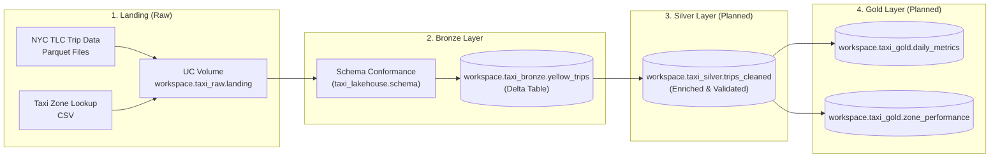

# NYC Taxi Lakehouse 🚖

[](https://docs.databricks.com/dev-tools/bundles/index.html)
[](https://delta.io/)
[](https://spark.apache.org/)
[](https://www.python.org/)
[](https://github.com/astral-sh/uv)

An end-to-end modern Lakehouse data engineering project built on **Databricks**, processing New York City Taxi and Limousine Commission (TLC) trip record data. Designed around the **Medallion Architecture**, **Unity Catalog**, and **Databricks Asset Bundles (DABs)**, with support for local execution via **Databricks Connect v18**.

---

## 🏛 Architecture Overview

The pipeline ingests raw monthly taxi trip files and reference data into a Unity Catalog landing volume, enforces strict schema conformity, and persists clean records into Delta Lake tables.



### Medallion Layers

| Layer | Catalog / Schema / Path | Description | Format |
|---|---|---|---|
| **Raw / Landing** | `/Volumes/workspace/taxi_raw/landing/` | Direct download landing zone for monthly yellow taxi parquet files and zone lookup CSV. | Parquet, CSV |
| **Bronze** | `workspace.taxi_bronze.yellow_trips` | Standardized raw data: snake_case column normalization and strict PySpark type casting. | Delta Lake |
| **Silver** *(in progress)* | `workspace.taxi_silver` | Cleaned trips filtered for valid coordinates, non-negative fares/distances, enriched with zone names. | Delta Lake |
| **Gold** *(planned)* | `workspace.taxi_gold` | Aggregated business KPIs (hourly demand, average fare/tip by zone, congestion pricing impact). | Delta Lake |

---

## 📁 Repository Structure

```text
nyc_taxi-DB-DE/
├── .databricks/                  # Databricks workspace configuration & state
├── .vscode/                      # VS Code Databricks extension settings
├── notebooks/                    # Interactive analysis and pipeline notebooks
│   ├── 00_setup.ipynb            # Creates schemas, volumes, and downloads raw data
│   ├── 01_explore_schema.ipynb   # Data discovery, date partitioning, and schema inspection
│   ├── 01_bronze.ipynb           # Ingestion & schema application into Bronze Delta table
│   └── test-experimentations/    # Local verification & testing notebooks
│       ├── test_conformity_2.ipynb # Row count and schema consistency verification
│       └── test_local_db.ipynb   # Databricks Connect local interactive session test
├── src/                          # Reusable Python lakehouse library
│   └── taxi_lakehouse/
│       ├── __init__.py
│       └── schema.py             # Column rename mappings, TARGET_SCHEMA, and apply_schema()
├── databricks.yml                # Databricks Asset Bundle (DAB) declaration
├── pyproject.toml                # Project metadata, dependencies, and environment locks
├── uv.lock                       # Deterministic dependency resolution file
└── README.md                     # Project documentation
```

---

## ⚙️ Key Technical Features

- **Databricks Asset Bundles (DABs)**: Declarative project definition via `databricks.yml` to target development and production workspaces seamlessly.
- **Databricks Connect v18**: Interactive remote Spark execution from local IDEs and notebooks without requiring a full local Spark cluster.
- **Fast Package Management**: Managed with [`uv`](https://github.com/astral-sh/uv) and Python 3.12 for sub-second virtualenv setup and reproducible builds.
- **Schema Enforcement & Conformance**: Centralized PySpark schema definitions in `src/taxi_lakehouse/schema.py`:
  - Standardizes raw column naming (`VendorID` → `vendor_id`, `tpep_pickup_datetime` → `pickup_ts`, `DOLocationID` → `do_location_id`, etc.).
  - Enforces explicit Spark data types across all 20 source columns (Integer, Double, String, TimestampNTZ).

---

## 🚀 Getting Started

### Prerequisites

- **Python 3.12** installed
- **[uv](https://docs.astral.sh/uv/)** installed (`pip install uv` or `curl -LsSf https://astral.sh/uv/install.sh | sh`)
- A **Databricks Workspace** with Unity Catalog enabled
- **Databricks CLI** configured with authentication

### 1. Clone & Set Up the Environment

```bash
git clone https://github.com/YahyaGhallali/nyc_taxi-DB-DE.git
cd nyc_taxi-DB-DE

# Create virtual environment and install locked dependencies
uv sync
```

### 2. Configure Databricks Connection

Verify your connection to your Databricks workspace:

```bash
databricks auth login --host https://dbc-733cc0e9-2912.cloud.databricks.com
```

If developing locally in VS Code, ensure the **Databricks extension** is configured to point to your development cluster or serverless compute.

### 3. Execution Workflow

1. **Initialize Storage & Ingestion (`00_setup.ipynb`)**:
   - Creates schemas: `taxi_raw`, `taxi_bronze`, `taxi_silver`, `taxi_gold`.
   - Creates the landing volume `/Volumes/workspace/taxi_raw/landing/`.
   - Downloads NYC Yellow Taxi monthly Parquet and zone CSV into the volume.

2. **Schema Exploration (`01_explore_schema.ipynb`)**:
   - Inspects the landing Parquet schema.
   - Evaluates monthly date ranges to identify out-of-bounds trip timestamps.

3. **Bronze Ingestion (`01_bronze.ipynb`)**:
   - Reads raw files from the landing volume.
   - Applies `apply_schema()` from `taxi_lakehouse.schema`.
   - Overwrites / appends into `workspace.taxi_bronze.yellow_trips` as a managed Delta table.

---

## 📊 Target Bronze Schema

The 20 standardized fields enforced by `taxi_lakehouse.schema.TARGET_SCHEMA`:

| Column | Type | Column | Type |
|---|---|---|---|
| `vendor_id` | `Integer` | `fare_amount` | `Double` |
| `pickup_ts` | `TimestampNTZ` | `extra` | `Double` |
| `dropoff_ts` | `TimestampNTZ` | `mta_tax` | `Double` |
| `passenger_count` | `Integer` | `tip_amount` | `Double` |
| `trip_distance` | `Double` | `tolls_amount` | `Double` |
| `rate_code_id` | `Integer` | `improvement_surcharge` | `Double` |
| `store_and_fwd_flag`| `String` | `total_amount` | `Double` |
| `pu_location_id` | `Integer` | `congestion_surcharge` | `Double` |
| `do_location_id` | `Integer` | `airport_fee` | `Double` |
| `payment_type` | `Integer` | `cbd_congestion_fee` | `Double` |

---

## 🗺 Roadmap

- [x] Unity Catalog schema & landing volume setup
- [x] Python package structure with schema casting utilities
- [x] Bronze layer Delta table ingestion
- [ ] Silver layer data quality rules (timestamp validity, positive amounts)
- [ ] Dimension lookup join with Taxi Zones (`taxi_zone_lookup.csv`)
- [ ] Automated scheduled jobs defined via Databricks Asset Bundles workflow
- [ ] Data quality assertions with Great Expectations or Delta Live Tables (DLT)
